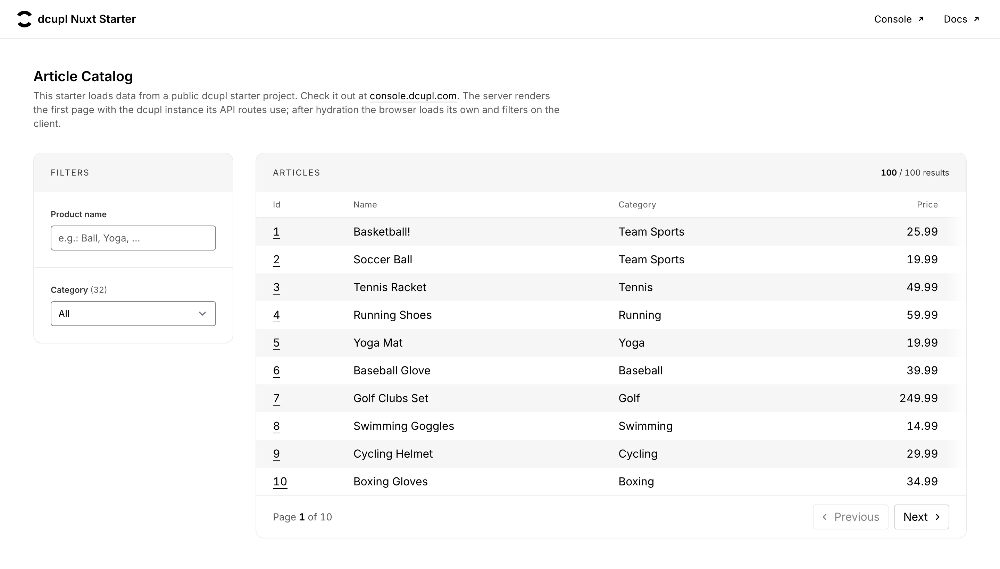

# dcupl Nuxt Starter




## Intro
This project is a Nuxt starter template integrating [dcupl](https://docs.dcupl.com) for data filtering on the server and in the browser. It uses data and models from the **"Product Catalog"** console project. You can start by exploring the provided data and models and even create your own console project based on the Starter Catalog to update data and models as needed.

**Stack:** Nuxt 4 (`app/` directory layout), [`@dcupl/nuxt`](https://github.com/dcupl/dcupl-nuxt) 0.1 with the dcupl SDK 2.1 (`@dcupl/core`, `@dcupl/common`), Tailwind CSS 4 via `@tailwindcss/vite`. Requires Node.js `^22.22.3 || ^24.15.0 || >=26.0.0` (what Nuxt 4.6 requires).

## How it works
- `app/pages/index.vue` lists the articles with filters and paging, `app/pages/articles/[key].vue` shows one article, `server/api/article/[key].ts` returns one article as JSON (404 for an unknown key).
- `app/utils/filters.ts` turns the filter inputs into list conditions (`setCondition`, `removeGroup`); every filter change goes back to page 1. `app/composables/usePaging.ts` holds the paging.
- The first page is rendered on the server with the dcupl instance of the server process, which the API routes share. The module checks the console project for changes at most once a minute and swaps in a new instance in the background.
- After hydration the browser builds its own dcupl instance, and filtering and paging run client-side.
- `test/article-catalog.spec.ts` runs the same filter and paging calls against an in-memory dcupl instance with 25 articles; `npm test` runs it without network.

## Look and Feel
The pages use the look of the dcupl console, the same as the dcupl Angular starter, built with Tailwind CSS only:

- `app/assets/css/main.css` adds the console palette next to Tailwind's default palette, prefixed `dcu-` (`dcu-black-*` and `dcu-white-*` are alpha scales where `-50` is the solid colour, plus `dcu-blue`, `dcu-yellow`, `dcu-green`, `dcu-red`), the focus ring, and a few small classes: `dcu-panel` (the card), `dcu-panel-header` (its tinted header strip), `dcu-scroll-x` (a horizontally scrolling region with a fading right edge) and the buttons `dcu-button`, `dcu-button-black`, `dcu-button-outline`, `dcu-button-clear`, named like their console counterparts.
- The font is [Inter](https://rsms.me/inter/), self-hosted from the `@fontsource-variable/inter` package, as an open-source stand-in for the console font.
- Everything else is Tailwind utilities in the component templates; `app/error.vue` styles the 404 page.

## Make it yours
1. **Your project.** Create a project in the [dcupl Console](https://console.dcupl.com), for example from the "Product Catalog" starter, and put its **projectId** and **apiKey** into `nuxt.config.ts`:

   ```ts
   dcupl: {
     config: {
       projectId: "<YOUR_PROJECT_ID>",
       apiKey: "<YOUR_API_KEY>",
     },
     // optional: GET /api/reload-dcupl?token=<secret> rebuilds the server instance right away
     // reloadHook: { secret: "<YOUR_SECRET>" },
     // optional: time between update checks in ms (default 60000), false disables them
     // updateCheckInterval: 60_000,
   },
   ```

2. **Your model.** The pages expect an `Article` model with `productName`, `category` (both filterable), `price` and a `vendorId` reference, as in the "Product Catalog" project. For another model, change `modelKey: "Article"` in `app/pages/index.vue`, `app/pages/articles/[key].vue` and `server/api/article/[key].ts`, and the `Article` type in `app/pages/index.vue`.
3. **The filters.** Each `<text-filter>` and `<select-filter>` in `app/pages/index.vue` filters the `attribute` you give it; add one per attribute. The conditions they set are in `app/utils/filters.ts`.
4. **The columns.** The `columns` array in `app/pages/index.vue` sets the table head; the row cells below it in the template show the values. Change both together. The page size is `PAGE_SIZE` in `app/composables/usePaging.ts`.

All module options are described in the [`@dcupl/nuxt` README](https://github.com/dcupl/dcupl-nuxt#readme).

* [dcupl Console](https://console.dcupl.com)
* [dcupl Docs](https://docs.dcupl.com)
* [dcupl.com](https://dcupl.com)

## Setup

```bash
npm install
```

## Development server

Start the development server on `http://localhost:3000`:

```bash
npm run dev
```

## Production

```bash
npm run build     # builds into .output/
npm run preview   # or: PORT=3000 node .output/server/index.mjs
```

Check out the [Nuxt deployment documentation](https://nuxt.com/docs/getting-started/deployment) for more information.
